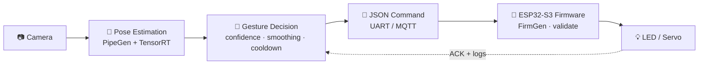

<div align="center">

# ✋ GestureLink AI

### Raise an arm. Control a device. Touch nothing.

**A Physical AI system that turns arm gestures into real-world actions,<br>using live pose estimation and an ESP32-S3 microcontroller.**


[🎥 Demo Video](#) 


</div>

---

## ⚡ At a Glance

| | |
|---|---|
| **What** | Touchless device control from arm gestures |
| **Input** | A single camera |
| **Brain** | Pose estimation → gesture validation (PipeGen + TensorRT) |
| **Output** | Validated commands to an ESP32-S3 (LED, servo) |
| **Why it matters** | Hands-free control for accessibility, kitchens, labs, and smart spaces |

---

## 🎯 The Idea

> Switches and touchscreens assume your hands are free, clean, and within reach. Often they aren't.

GestureLink AI watches you through a camera, decides whether you made a **deliberate** gesture, and sends a checked command to a microcontroller that acts on it.

| Gesture | Command | Result |
|:---:|:---:|:---|
| 🙋‍♂️ **Right arm up** | `LIGHT_ON` | 💡 Light turns **on** |
| 🙋‍♀️ **Left arm up** | `LIGHT_OFF` | 🌑 Light turns **off** |
| 🙌 **Both arms up** | `SERVO_OPEN` | 🚪 Servo **opens** |

---

## 🔄 How It Works



| Step | What happens |
|:---:|---|
| **1. See** | The camera streams video to the PipeGen pipeline. |
| **2. Locate** | Pose estimation finds shoulders, elbows, and wrists. |
| **3. Decide** | Arm position, keypoint confidence, and stability over time decide whether the gesture is real. |
| **4. Send** | A stable gesture becomes a structured JSON command. |
| **5. Act** | The ESP32-S3 validates the command and drives the output. |
| **6. Prove** | Logs, acceptance tests, and hardware runs give evidence it worked. |

The device's acknowledgement closes the loop, so we can tell a command that was **generated** from one that was **executed**.

---

## 🛡️ Reliability by Design

The hardest part of gesture control isn't detecting a gesture. It's **not** reacting to one you didn't mean.

| Safeguard | Stops this from happening |
|---|---|
| 🎚️ Confidence thresholds | Acting on noisy or hidden keypoints |
| 🕒 Temporal smoothing | A one-frame glitch triggering a command |
| ⏱️ Cooldown | One held gesture firing again and again |
| ✅ Firmware input validation | Malformed commands reaching hardware |
| 🔌 Modular transport adapters | Being locked to one protocol (UART ↔ MQTT) |
| 📝 Structured logging | Behavior you can't debug or audit |
| 🔗 Requirements traceability | Features with no test behind them |

---

## 🧰 Tech Stack

| Layer | Tools |
|---|---|
| 👁️ **Perception** | CraftifAI PipeGen · human pose estimation · gesture classification |
| ⚡ **Inference** | TensorRT on NVIDIA GPU / Jetson |
| 🔧 **Firmware** | CraftifAI FirmGen · ESP-IDF 5.5.5 · C |
| 🧩 **Hardware** | ESP32-S3 · LED · servo |
| 📡 **Transport** | JSON over UART serial or MQTT |
| 🧪 **Testing** | Wokwi virtual circuit · serial-log verification |

---

## 📡 Command Protocol

Supported commands: `LIGHT_ON` · `LIGHT_OFF` · `SERVO_OPEN`. Anything else is rejected and logged.

```jsonc
// Sent by the vision pipeline        // Returned by the firmware
{ "cmd": "LIGHT_ON" }                 { "status": "ok", "cmd": "LIGHT_ON" }
```

> Field names are illustrative. Match them to your implementation.

---

## 🚀 Quick Start

<details>
<summary><b>🔌 Firmware (ESP32-S3)</b></summary>

```bash
cd firmware
idf.py set-target esp32s3
idf.py build
idf.py -p <PORT> flash monitor
```
</details>

<details>
<summary><b>🧪 Virtual test (Wokwi)</b></summary>

1. Open the Wokwi project in `/wokwi` and start the simulation.
2. Type a command in the serial monitor, e.g. `LIGHT_ON`.
3. Confirm the LED responds and the log shows the command.
</details>

<details>
<summary><b>👁️ Vision pipeline (PipeGen)</b></summary>

```bash
cd pipeline
# Requirement → Pipeline IR → Model → Compiler (TensorRT) → Run
```
</details>

> Replace the commands above with the exact ones for your repo layout.

---


> **Our standard:** a requirement is "done" only when it is shown with reproducible test evidence on the required hardware.
> *Update the table above to your final state before submitting.*

### 📈 Results

| Metric | Value |
|---|:---:|
| TensorRT inference speed (FPS / latency) | `TBD` |
| End-to-end gesture → action latency | `TBD` |
| False-activation rate | `TBD` |
| Acceptance tests passed | `TBD` |

---

## 🌍 Use Cases

| 🦽 Accessibility | 🍳 Kitchens | 🔬 Labs | 🏠 Smart Homes |
|---|---|---|---|
| Hands-free control for limited mobility | Control devices with messy hands | Touch-free in sterile spaces | Lights and appliances from across the room |

## 🗺️ Roadmap

-  Wokwi LED + serial-command baseline
-  Complete PipeGen pipeline with TensorRT benchmarks
-  Requirements-driven firmware passing acceptance tests
-  Live closed-loop demo on real hardware
-  More gestures and per-user calibration
-  Multi-device control

---

## 🏆 Why GestureLink AI?

Most vision demos stop at *"the model detected something."*

GestureLink AI goes the whole way: **perception → decision → transport → firmware → physical action**, with safeguards and test evidence at every stage. That is what **Physical AI** means.

<div align="center">

**👁️ See the gesture. 🧠 Understand the intent. ⚡ Execute the action.**

</div>

---

## 👥 Team Magneta

`Dharshini R ` · `Dharshika S` · `Sudharshan ` `Shobik `

